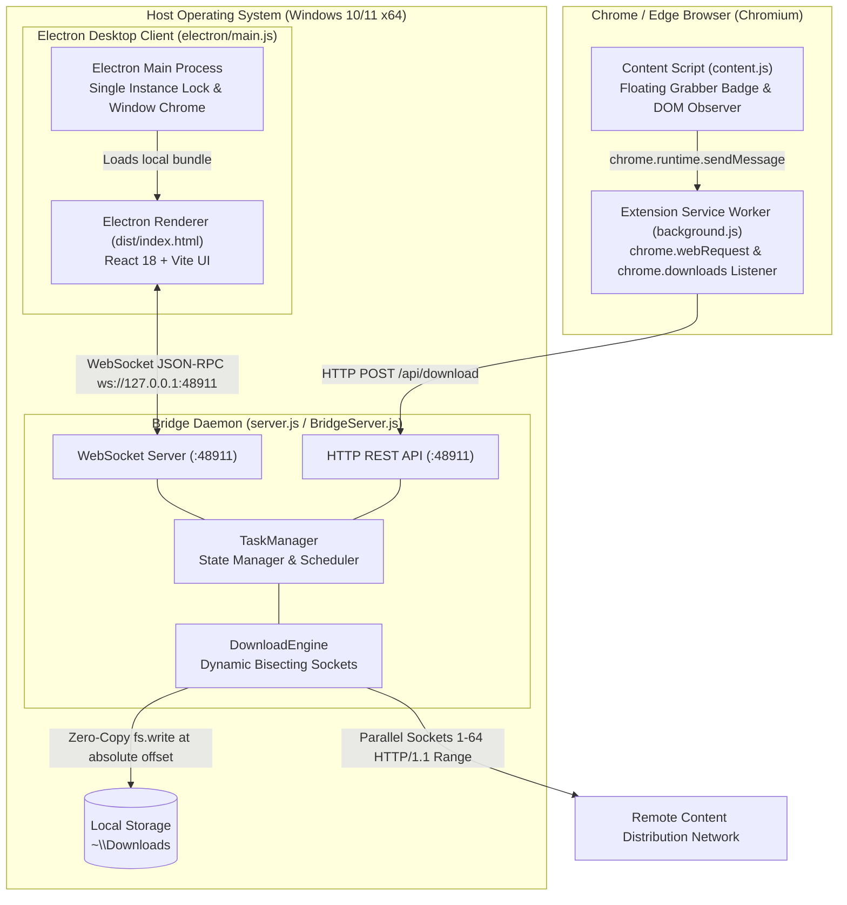
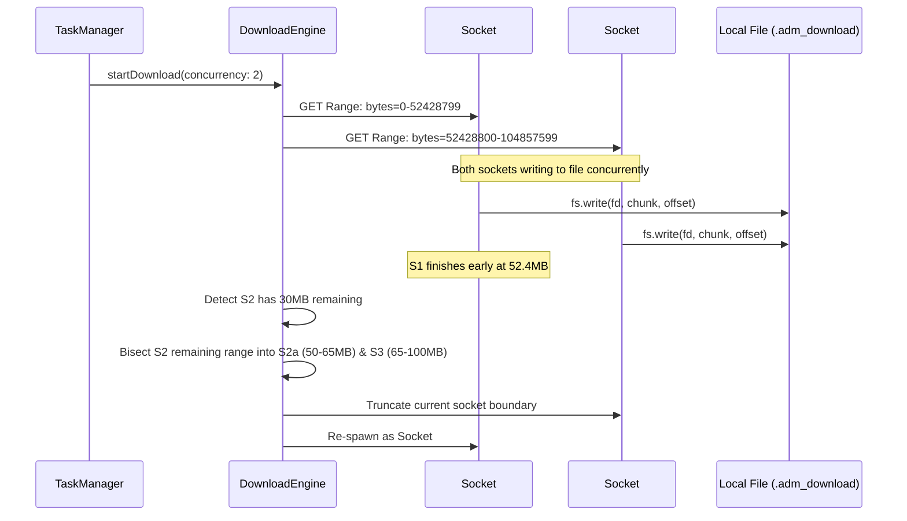
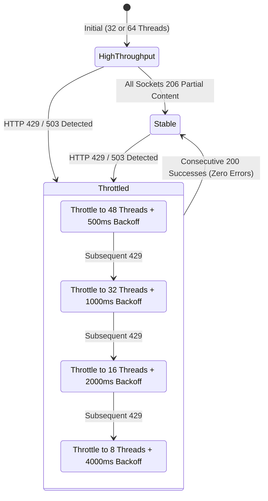

# Architecture & Engine Internals

This document provides a comprehensive technical overview of the architecture, algorithms, concurrency models, and network protocols powering **Apex Download Manager (ADM) 6.42 Pro**.

---

## 1. System Topology & Process Boundaries

Apex Download Manager operates across four distinct execution environments communicating over standardized IPC and WebSocket protocols:



### Process Isolation Rationale
- **Bridge Independence**: The `BridgeServer` operates as an independent headless Node.js daemon. If the Electron UI window is closed or refreshed (<kbd>Ctrl+R</kbd>), background downloads continue uninterrupted at full line rate.
- **Single Instance Enforcement**: `electron/main.js` acquires `app.requestSingleInstanceLock()`. Secondary launches focus the primary window and exit immediately, eliminating socket conflicts on port `48911`.

---

## 2. Dynamic Bisecting Range Segmentation Algorithm

Standard download managers allocate a fixed number of segments upfront. If one connection stalls or encounters a slower server thread, the overall download is bottlenecked.

ADM utilizes a **Dynamic Range Bisecting Algorithm**:



### Algorithm Steps:
1. **Probe Phase**: Issues an HTTP `HEAD` request to verify:
   - Server returns `Accept-Ranges: bytes`.
   - Extract exact `Content-Length`.
   - Extract canonical file name from `Content-Disposition` or URL pathname.
2. **Initial Partition**: The file of length $L$ is divided into $N$ equal continuous segments:
   $$\text{Range}_i = \left[ i \cdot \left\lfloor\frac{L}{N}\right\rfloor, (i+1) \cdot \left\lfloor\frac{L}{N}\right\rfloor - 1 \right]$$
3. **Dynamic Bisecting During Runtime**:
   - Every 500ms, the engine surveys active sockets.
   - If user adjusts the thread slider from $M \to K$ ($K > M$), or an idle socket finishes early, the engine locates the active socket with the largest remaining byte delta.
   - The unread portion of that segment is bisected at midpoint $\text{mid} = \text{current} + \lfloor(\text{end} - \text{current}) / 2\rfloor$.
   - A new socket is spawned for $[\text{mid} + 1, \text{end}]$, saturating high-bandwidth connections up to 64 parallel threads.

---

## 3. Zero-Copy Positional Disk I/O

Traditional downloaders write chunks to separate temporary files on disk (e.g. `part1.tmp`, `part2.tmp`) and concatenate them at completion. For a 50GB file, concatenation takes minutes and causes severe disk I/O thrashing.

ADM implements **Zero-Copy Direct Positional Writes**:
1. At task inception, ADM creates a single `.adm_download` target file.
2. It expands or seeks directly to the target length using `fs.open(path, 'w+')`.
3. Incoming TCP network buffers are written directly to their absolute position in the file using positional `fs.write`:
   ```javascript
   fs.write(fileDescriptor, buffer, 0, buffer.length, absoluteByteOffset, callback);
   ```
4. **Zero Reassembly Time**: When all segments reach 100%, the file is already 100% assembled. ADM simply closes the descriptor and executes an atomic `fs.rename` to the final filename.

---

## 4. Adaptive HTTP 429 Step-Down Throttle State Machine

Aggressive multi-threaded downloads risk triggering CDN rate limits (`HTTP 429 Too Many Requests` or `HTTP 503 Service Unavailable`). 

ADM incorporates an automatic step-down state machine:



- **Safety Guarantee**: In restrictive environments (e.g., Cloudflare WAF, Akamai Bot Manager), ADM steps down socket concurrency automatically without terminating or corrupting the download.

---

## 5. Manifest V3 Video Sniffer & Stream Detection

The browser extension integrates via Chrome's Manifest V3 standard without running legacy background pages.

### Capture Pipeline:
1. **Network Header Sniffing (`chrome.webRequest`)**:
   - Listens on `onHeadersReceived` for mime-types matching `video/*`, `audio/*`, `application/x-mpegURL`, `application/vnd.apple.mpegurl`, and `application/dash+xml`.
   - Filters out small video fragments (< 1.5MB) to avoid catching ad tracking pixels.
2. **DOM Video Observer (`content.js`)**:
   - Injects a `MutationObserver` inspecting `video` and `audio` elements.
   - Extracts current `.currentSrc` or child `source` URLs.
   - Matches regex patterns for 1080p, 720p, 480p, and audio tracks.
3. **Frosted Glass Floating Pill**:
   - Renders a shadow-DOM isolated button directly on video player overlays (YouTube, Vimeo, Twitter, direct streams).
   - Clicking sends an IPC message to `background.js`, which issues a REST POST to `http://127.0.0.1:48911/api/download`.
